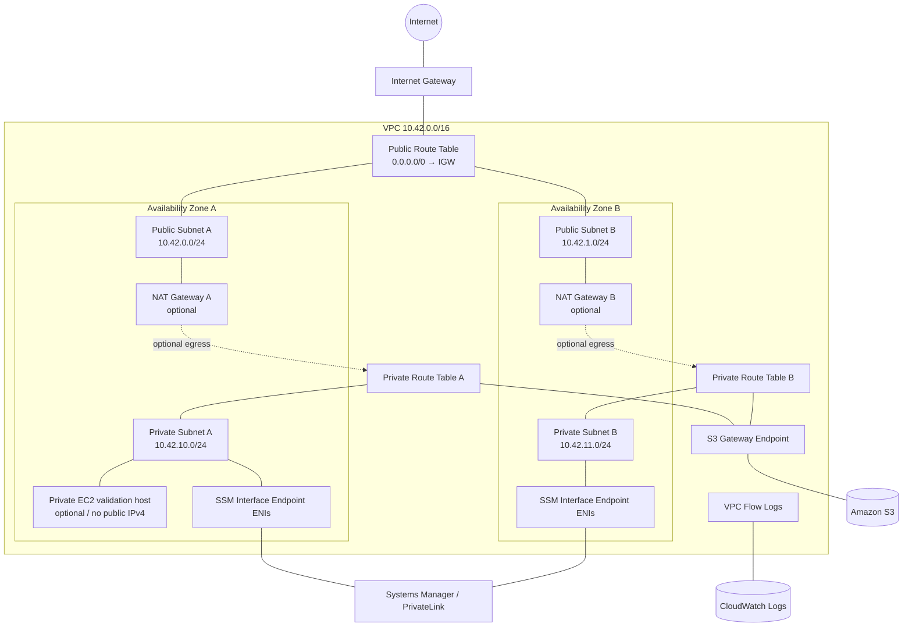

# AWS Networking Rebuild

Employer-facing AWS networking portfolio project built with Terraform to demonstrate current hands-on architecture, validation, observability, and deliberate troubleshooting.

> **Evidence classification:** production-like independent project / hands-on lab evidence. This repository does **not** represent professional production AWS networking tenure.

## Current implementation status

**Phase 1 — Two-AZ VPC Foundation: implementation prepared; deployment and validation pending.**

The Terraform source is ready for local validation and controlled deployment. Until the healthy baseline is actually applied and validated, this README intentionally describes the design as **prepared/planned**, not completed evidence.

See [`IMPLEMENTATION_STATUS.md`](IMPLEMENTATION_STATUS.md) for the authoritative project-state boundary.

## Why this project exists

This project serves three connected purposes:

1. rebuild current AWS networking fluency through hands-on work;
2. produce interview-ready troubleshooting evidence;
3. provide a clean employer-facing AWS networking repository for the GitHub engineering portfolio.

The governing career direction is Cloud Infrastructure / Platform Engineering / Production Systems. The repository is designed to show architecture judgment and troubleshooting discipline without inflating lab work into employer production experience.

## Phase 1 architecture

Prepared Phase 1 scope:

- 1 VPC (`10.42.0.0/16` by default)
- 2 Availability Zones
- 2 public subnets
- 2 private subnets
- Internet Gateway
- public and private route tables
- optional NAT Gateway per AZ for bounded IPv4-egress validation
- explicit private-subnet NACL
- security groups
- S3 Gateway VPC Endpoint
- Systems Manager Interface Endpoints (`ssm`, `ssmmessages`)
- VPC Flow Logs to CloudWatch Logs
- optional private EC2 validation instance managed through Systems Manager

NAT gateways and the EC2 validation instance are **disabled by default** to control cost.

### Architecture diagram



## What Phase 1 is designed to demonstrate

### Architecture

- public vs private subnet behavior;
- multi-AZ network layout;
- route-table association and default-route reasoning;
- IGW vs NAT Gateway selection;
- same-AZ NAT routing for bounded HA-oriented validation;
- Gateway vs Interface VPC Endpoint selection.

### Security and operations

- no inbound SSH requirement for the private validation instance;
- Session Manager-oriented administration;
- security-group vs NACL behavior;
- VPC Flow Logs for evidence-driven troubleshooting;
- IMDSv2 enforcement on the optional EC2 validation host.

### Troubleshooting

After the healthy baseline is validated, the project deliberately introduces controlled faults around:

- private-subnet internet egress;
- route-table association;
- interface-endpoint security-group rules;
- NACL/stateless return-path behavior.

Each drill uses:

**symptom → hypothesis → evidence checked → root cause → fix → prevention**

## Repository structure

```text
.
├── README.md
├── IMPLEMENTATION_STATUS.md
├── SECURITY.md
├── terraform/
│   ├── network.tf
│   ├── endpoints.tf
│   ├── flow-logs.tf
│   ├── ssm-test-instance.tf
│   ├── variables.tf
│   ├── outputs.tf
│   └── terraform.tfvars.example
├── scripts/
│   ├── 01-init-validate.ps1
│   ├── 02-plan.ps1
│   ├── 03-apply.ps1
│   └── 99-destroy.ps1
└── docs/
    ├── architecture-decisions.md
    ├── validation-checklist.md
    ├── validation-evidence.md
    ├── failure-drills.md
    ├── troubleshooting-log.md
    ├── public-readiness-checklist.md
    ├── interview-explain-backs.md
    └── cost-control.md
```

## Prerequisites

- Terraform >= 1.6
- AWS CLI v2
- PowerShell 7+ recommended on Windows
- authenticated AWS profile with permission to create the lab resources

No credential material belongs in this repository.

## Controlled quick start — PowerShell

From the repository root:

```powershell
Set-Location .\terraform
Copy-Item .\terraform.tfvars.example .\terraform.tfvars

# Review terraform.tfvars before continuing.
..\scripts\01-init-validate.ps1 -Profile ekewaka
..\scripts\02-plan.ps1 -Profile ekewaka
```

**Stop after the plan and review it before applying.**

Only after the plan is reviewed:

```powershell
..\scripts\03-apply.ps1 -Profile ekewaka
```

## Cost-controlled testing

The baseline keeps expensive optional test paths disabled:

```hcl
enable_nat_gateways  = false
enable_test_instance = false
```

Later, during the bounded egress/SSM test window:

```hcl
enable_nat_gateways  = true
enable_test_instance = true
```

Review [`docs/cost-control.md`](docs/cost-control.md) before enabling those resources.

## Validation evidence

The project is not considered implemented merely because Terraform applies successfully.

Before changing `IMPLEMENTATION_STATUS.md` to validated, complete [`docs/validation-checklist.md`](docs/validation-checklist.md) and record sanitized findings in [`docs/validation-evidence.md`](docs/validation-evidence.md).

Do **not** commit:

- AWS account IDs;
- credentials/tokens;
- raw `terraform.tfstate`;
- `.tfvars` containing environment-specific values;
- unreviewed CLI output;
- screenshots containing account-identifying UI elements;
- unrelated personal or employer information.

## Phase 1 failure-recovery evidence

Do not inject faults before the healthy baseline is captured.

Then use [`docs/failure-drills.md`](docs/failure-drills.md) and record performed drills in [`docs/troubleshooting-log.md`](docs/troubleshooting-log.md).

## Teardown

```powershell
Set-Location .\terraform
..\scripts\99-destroy.ps1 -Profile ekewaka
```

After teardown, independently verify that no lab NAT Gateways, EIPs, interface endpoints, EC2 instances, or other billable lab resources remain.

## Phase 2 roadmap

After Phase 1 is validated, this same repository is intended to expand with:

- second VPC;
- VPC Peering;
- reciprocal routing;
- private connectivity tests;
- cross-VPC DNS validation;
- Route 53 private hosted zone / resolver concepts;
- PrivateLink comparison;
- Transit Gateway design and cost-controlled validation/modeling.

Planned Phase 2 work must remain labeled **planned** until actually performed.

## What this demonstrates

When Phase 1 evidence is complete, the repository is intended to demonstrate:

- Terraform-based AWS networking implementation;
- multi-AZ subnet/routing architecture;
- private connectivity and VPC endpoint selection;
- security-control reasoning;
- network observability;
- deliberate failure injection and recovery;
- cost-aware infrastructure lifecycle management;
- clear separation between design intent, performed implementation, and validated evidence.

It does **not** demonstrate years of professional AWS networking experience or enterprise Transit Gateway ownership.
