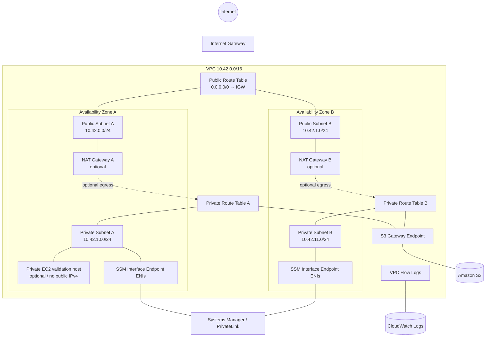

# AWS Networking Rebuild

Employer-facing AWS networking portfolio project built with Terraform to demonstrate current hands-on architecture, validation, observability, and deliberate troubleshooting.

> **Evidence classification:** production-like independent project / hands-on lab evidence. This repository does **not** represent professional production AWS networking tenure.

## Current implementation status

**Phase 1 — Two-AZ VPC Foundation: deployed, validated, controlled break/fix drills completed, and infrastructure destroyed. Public-readiness review pending.**

The Terraform source remains available for controlled reproduction; the lab is no longer running. The completed networking and recovery tests are recorded in [validation evidence](docs/validation-evidence.md) and the [troubleshooting log](docs/troubleshooting-log.md). Phase 2 is still planned.

See [`IMPLEMENTATION_STATUS.md`](IMPLEMENTATION_STATUS.md) for the authoritative project-state boundary.

## Why this project exists

This project serves three connected purposes:

1. rebuild current AWS networking fluency through hands-on work;
2. produce interview-ready troubleshooting evidence;
3. provide a clean employer-facing AWS networking repository for the GitHub engineering portfolio.

The governing career direction is Cloud Infrastructure / Platform Engineering / Production Systems. The repository is designed to show architecture judgment and troubleshooting discipline without inflating lab work into employer production experience.

## Terraform layout

This project intentionally separates Terraform resources by responsibility rather than using a single `main.tf`.

Terraform automatically loads all `.tf` files in the working directory as one configuration.

- `network.tf` — VPC, subnets, routing, NACLs, and security groups
- `endpoints.tf` — S3 and Systems Manager VPC endpoints
- `flow-logs.tf` — VPC Flow Logs and CloudWatch integration
- `ssm-test-instance.tf` — optional private validation instance
- `variables.tf` — input variables
- `outputs.tf` — exported resource information

## Phase 1 architecture

Implemented and validated Phase 1 scope (resources subsequently destroyed):

- 1 VPC (`10.42.0.0/16` by default)
- 2 Availability Zones
- 2 public subnets
- 2 private subnets
- Internet Gateway
- public and private route tables
- optional NAT Gateway per AZ for bounded IPv4-egress validation
- explicit private-subnet NACL
- security groups
- S3 Gateway VPC Endpoint
- Systems Manager Interface Endpoints (`ssm`, `ssmmessages`)
- VPC Flow Logs to CloudWatch Logs
- optional private EC2 validation instance managed through Systems Manager

NAT gateways and the EC2 validation instance are **disabled by default** to control cost.

### Architecture diagram



## What Phase 1 demonstrated

### Architecture

- public vs private subnet behavior;
- multi-AZ network layout;
- route-table association and default-route reasoning;
- IGW vs NAT Gateway selection;
- same-AZ NAT routing for bounded HA-oriented validation;
- Gateway vs Interface VPC Endpoint selection.

### Security and operations

- no inbound SSH requirement for the private validation instance;
- Session Manager-oriented administration;
- security-group vs NACL behavior;
- VPC Flow Logs for evidence-driven troubleshooting;
- IMDSv2 enforcement on the optional EC2 validation host.

### Troubleshooting

After validating the healthy baseline, the project deliberately reproduced and recovered two faults:

- removing a private subnet's NAT default route, which blocked external HTTPS while S3 Gateway Endpoint access remained available;
- revoking the private EC2 security group's outbound allow rule, which reproduced egress failure (user-confirmed; raw command output not retained).

Other suggested drills remain unperformed.

Each drill uses:

**symptom → hypothesis → evidence checked → root cause → fix → prevention**

## Visual learning / AWS Console verification

Terraform remains the source of truth, and AWS CLI/API checks remain the reproducible validation mechanism. This project also includes an optional AWS Console visual-verification layer for mapping IaC resources to what AWS actually shows.

Default workflow mode: **GUI ASK**.

Supported modes:

- **GUI ASK** — offer the Console walkthrough at meaningful checkpoints.
- **GUI ALWAYS** — include the walkthrough automatically.
- **GUI OFF** — Terraform/CLI only.
- **SHOW GUI** — one-time visual walkthrough.
- **SKIP GUI** — skip one visual checkpoint.

Console walkthroughs are read-only by default. Do not manually change Terraform-managed resources unless a step is explicitly designated as a drift/failure exercise.

See [`docs/aws-console-visual-guide.md`](docs/aws-console-visual-guide.md).

## Repository structure

```text
.
├── README.md
├── IMPLEMENTATION_STATUS.md
├── SECURITY.md
├── terraform/
│   ├── network.tf
│   ├── endpoints.tf
│   ├── flow-logs.tf
│   ├── ssm-test-instance.tf
│   ├── variables.tf
│   ├── outputs.tf
│   └── terraform.tfvars.example
├── scripts/
│   ├── 01-init-validate.ps1
│   ├── 02-plan.ps1
│   ├── 03-apply.ps1
│   └── 99-destroy.ps1
└── docs/
    ├── architecture-decisions.md
    ├── aws-console-visual-guide.md
    ├── validation-checklist.md
    ├── validation-evidence.md
    ├── failure-drills.md
    ├── troubleshooting-log.md
    ├── public-readiness-checklist.md
    ├── interview-explain-backs.md
    └── cost-control.md
```

## Prerequisites

- Terraform >= 1.6
- AWS CLI v2
- PowerShell 7+ recommended on Windows
- authenticated AWS profile with permission to create the lab resources

No credential material belongs in this repository.

## Controlled quick start — PowerShell

From the repository root:

```powershell
Set-Location .\terraform
Copy-Item .\terraform.tfvars.example .\terraform.tfvars

# Review terraform.tfvars before continuing.
..\scripts\01-init-validate.ps1 -Profile ekewaka
..\scripts\02-plan.ps1 -Profile ekewaka
```

**Stop after the plan and review it before applying.**

Only after the plan is reviewed:

```powershell
..\scripts\03-apply.ps1 -Profile ekewaka
```

## Cost-controlled testing

The baseline keeps expensive optional test paths disabled:

```hcl
enable_nat_gateways  = false
enable_test_instance = false
```

Later, during the bounded egress/SSM test window:

```hcl
enable_nat_gateways  = true
enable_test_instance = true
```

Review [`docs/cost-control.md`](docs/cost-control.md) before enabling those resources.

## Validation evidence

The project is not considered implemented merely because Terraform applies successfully.

Phase 1 has been validated and the sanitized findings are recorded in [`docs/validation-evidence.md`](docs/validation-evidence.md). The original [`docs/validation-checklist.md`](docs/validation-checklist.md) remains a reproduction checklist, not a claim that every optional item was executed.

When visual learning is enabled, use [`docs/aws-console-visual-guide.md`](docs/aws-console-visual-guide.md) after the corresponding Terraform/CLI checkpoint. Console confirmation is supplemental and does not replace reproducible validation.

Do **not** commit:

- AWS account IDs;
- credentials/tokens;
- raw `terraform.tfstate`;
- `.tfvars` containing environment-specific values;
- unreviewed CLI output;
- screenshots containing account-identifying UI elements;
- unrelated personal or employer information.

## Phase 1 failure-recovery evidence

The healthy baseline was captured before the two performed fault injections.

The performed drills are recorded in [`docs/troubleshooting-log.md`](docs/troubleshooting-log.md); [`docs/failure-drills.md`](docs/failure-drills.md) also contains proposed drills that were not executed.

## Teardown

```powershell
Set-Location .\terraform
..\scripts\99-destroy.ps1 -Profile ekewaka
```

**Completed teardown:** Terraform destroy was executed; subsequent CLI checks showed both NAT Gateways deleted, the test EC2 terminated, the VPC absent, and Terraform state empty. The remaining CloudWatch Log Group was subsequently deleted according to the owner, without a preserved independent final lookup. A comprehensive audit of all possible residual billable resources is not claimed.

## Phase 2 roadmap

**Planned, not implemented:** This repository may expand with:

- second VPC;
- VPC Peering;
- reciprocal routing;
- private connectivity tests;
- cross-VPC DNS validation;
- Route 53 private hosted zone / resolver concepts;
- PrivateLink comparison;
- Transit Gateway design and cost-controlled validation/modeling.

Planned Phase 2 work must remain labeled **planned** until actually performed.

## What this demonstrates

Completed Phase 1 evidence demonstrates:

- Terraform-based AWS networking implementation;
- multi-AZ subnet/routing architecture;
- private connectivity and VPC endpoint selection;
- security-control reasoning;
- network observability;
- deliberate failure injection and recovery;
- cost-aware infrastructure lifecycle management;
- clear separation between design intent, performed implementation, and validated evidence.

It does **not** demonstrate years of professional AWS networking experience or enterprise Transit Gateway ownership.
